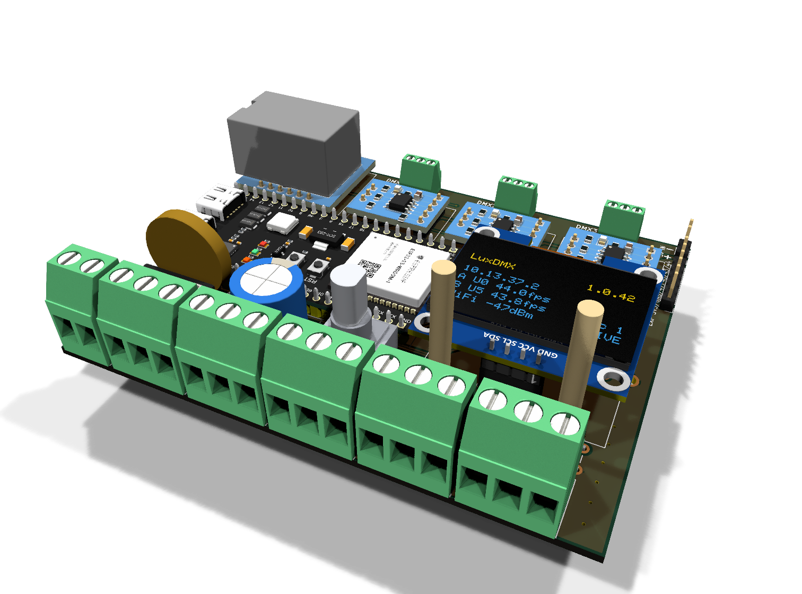

# LuxDMX carrier board

A 2-layer PCB for off-the-shelf modules: an ESP32-S3 dev board, up to three RS-485 modules, a
W5500 Ethernet module and an OLED. Encoder and two buttons sit on the board itself. DMX and RDM on
up to three ports, WS281x pixels on up to five.

The board is built and runs on the bench; most firmware testing happens on it.



| | |
|---|---|
| Board | 100 x 80 mm, 2 layers, 1 oz copper, no mounting holes |
| Revision | **rev 1.1**, printed on the silk (front between the buttons, back along the bottom edge). Boards without a rev on them are rev 1.0, see [Known issues](#known-issues) |
| DMX / RDM | up to 3 ports, one MAX3485 module each, direction pin driven, **not isolated** |
| Pixels | up to 5 WS281x ports, buffered to 5 V by a 74AHCT541 |
| Network | wired with a W5500 module (recommended), or WiFi with an external antenna, see [Network](#network-w5500-or-an-external-antenna) |
| Logic supply | USB-C on the ESP module, external 5 V, or a 5 V regulator module off the pixel rail (Pololu D24V10F5 recommended, MP1584EN, D36V28F5 and 78xx-style SIPs fit too) |
| Pixel supply | 12 or 24 V screw terminal, fused on the board, 9.8 A max |
| UI | 1.3" SH1106 OLED, EC11 encoder with push switch, two buttons |
| Firmware | **ESP32-S3 + PSRAM** image, then the **LuxDMX Carrier** board in `/config` |

Contents: [Modules](#modules) · [Pin map](#pin-map) · [Power](#power) · [DMX ports](#dmx-ports) ·
[Pixel ports](#pixel-ports) · [All parts](#all-parts) · [Build levels](#build-levels) ·
[Ordering](#ordering) · [Assembly](#assembly) · [Before you power it](#before-you-power-it) ·
[Firmware](#firmware) · [Known issues](#known-issues)

## Modules

These are the units the bench board is built with. Other sellers' modules work if pinout and
size match, check both before buying.

| Slot | Module | Pins | Notes |
|---|---|---|---|
| MCU | ESP32-S3-DevKitC-1 clone, **WROOM-1-N16R8**, dual USB-C (Binghe, Amazon.de B0D6B2CYNW). Search `ESP32-S3-DevKitC-1 N16R8` | 2 x 22, official DevKitC-1 pin order | 57.5 x 27.9 mm, rows **25.40 mm** apart. Espressif's own DevKitC-1 has 22.86 mm rows and does **not** fit. Compare the seller's drawing against the footprint before buying. For WiFi take the **WROOM-1U** version with an external antenna, see below |
| RS-485, x3 | MAX3485 module, silk `RS485 V2.01` (RAKSTORE, Amazon.de B0C2HRQ393). Search `MAX3485 TTL to RS485 module 3.3V` | left: GND / A / B<br>right: EN / VCC / RXD / TXD / GND | 3.3 V, not isolated. EN is DE and RE tied together, one GPIO per port, which is what RDM needs. A module without EN can't do RDM. RXD is the module's input (DI), TXD its output (RO); the board crosses them |
| Ethernet | USR-ES1 (W5500). Search `USR-ES1 W5500` | 2 x 6, rows 20.32 mm | 3.3 V only, no LDO on the module. About 132 mA typical. The single-row 8-pin W5500 boards are a different module |
| Display | 1.3" OLED, SH1106, 128 x 64, I2C. Search `1.3 inch OLED I2C SH1106` | board pads 1-4: GND / 3V3 / SCL / SDA | Sits on a 1x4 female socket, 8.5 mm tall, which lifts the glass 10.9 mm clear of the modules. Sold with VCC and GND in either order, read the module's silk |
| Encoder | EC11 with push switch, 20 mm D-shaft: Alps EC11E15244B2 (LCSC C470754) or any clone (the part inside a KY-040) | soldered to the board | GPIO pull-ups are internal, the KY-040's three 10k aren't needed. The Alps clicks every half step: set **Steps per detent = 2** in `/config` (clones: 4) |
| Buttons, x2 | 6 x 6 mm tact switch, K2-1102DP-C4SW-04 (5 mm, LCSC C110153) in the BOM | soldered to the board | Plunger 5 to 30 mm on the same land. The encoder shaft stands 20 mm, so behind a front panel take 30 mm switches (marketplace) or long caps; LCSC stops at 19 mm |

### Network: W5500, or an external antenna

The S3's antenna end sits in the middle of the board, over the ground copper and between the
RS-485 modules and the display, about 3 mm from the 5 V regulator spot on the back (an MP1584's
switch node ends up about 5 mm from a WROOM-1's antenna; a Pololu module is quieter). A module with the usual PCB antenna (WROOM-1) loses a lot of
range there, and modules, cables and an enclosure make it worse.

- **Recommended: the W5500 module.** Wired Ethernet, no radio questions.
- **WiFi only:** use a DevKitC-1 clone with the **ESP32-S3-WROOM-1U** (U.FL connector, e.g.
  `N16R8U`) and an external 2.4 GHz antenna led out of the enclosure. Same 25.40 mm rows as
  above, check the seller's drawing.
- A WROOM-1 board on the bench, without a case, is fine for trying things out.

## Pin map

From the board's nets. Picking **LuxDMX Carrier** in `/config` sets these.

| Function | GPIO |
|---|---|
| DMX 1 TX / RX / DE+RE | 17 / 18 / 16 |
| DMX 2 TX / RX / DE+RE | 15 / 7 / 6 |
| DMX 3 TX / RX / DE+RE | 5 / 4 / 8 |
| W5500 SCLK / MOSI / MISO / CS / INT / RST | 12 / 11 / 13 / 10 / 14 / 9 |
| Pixel 1 / 2 / 3 / 4 / 5 data (before the buffer) | 38 / 39 / 40 / 47 / 48 |
| Display SDA / SCL | 1 / 2 |
| Encoder A / B / switch | 42 / 41 / 21 |
| Button 1 / 2 (to GND) | 3 / 46 |
| `EXP` header | 3V3, GND, 47, 48, 43 (TX0), 44 (RX0) |

Not used, and not usable: 35/36/37 (octal PSRAM on any R8 module), 45 (flash voltage strap), 19/20
(USB), 0 (BOOT). IO48 also drives the module's own RGB LED, see [pixel ports](#pixel-ports).

## Power

### Rails

| Net | Comes from | Feeds |
|---|---|---|
| `+5V` | USB-C on the ESP module, **or** the `5V IN` header, **or** the buck module | ESP module 5V pin, 74AHCT541 |
| `+3V3` | the ESP module's own regulator (800 mA on Espressif's design) | ESP32-S3, MAX3485 x3, W5500, OLED, DMX bias, pull-ups |
| `V_PIX_IN` | `12-24V IN` screw terminal | the fuse |
| `V_PIX` | after the fuse | 1000 µF, V+ on all five pixel terminals, buck module input |
| `GND` | one common ground | everything, including DMX pin 1 (the ports are not isolated) |

The 3.3 V load with everything fitted is about 269 mA. The W5500 and WiFi don't run at the same time.

No ORing diodes between the three 5 V sources: **one at a time**. With the buck fitted, don't plug
in USB while the 12/24 V is on.

### Supply setups

| Setup | Fit | Logic from | Pixel rail |
|---|---|---|---|
| DMX only, bench | nothing | USB-C | unused |
| DMX only, in a box | `5V IN` header | external 5 V | unused |
| Pixels, two supplies | 12-24V terminal, fuse, 1000 µF | USB or `5V IN` | 12/24 V |
| Pixels, one supply | as above + buck module | buck, from `V_PIX` | 12/24 V |
| 5 V pixels | 12-24V terminal, fuse, 1000 µF, no buck | USB or `5V IN` | 5 V |

### 5 V pixels and USB

**USB never reaches the pixel terminals.** `V+` on all five is `V_PIX`, and `V_PIX` only comes from
the `12-24V IN` terminal through the fuse. Neither USB nor `5V IN` is connected to it. With nothing on
that terminal the data is there, `/pixels.json` shows the port running at full frame rate, and the
strip stays dark.

**WS2812 and other 5 V pixels:** the 5 V goes into `12-24V IN`, despite the name. The rail doesn't
care about the voltage. Leave the buck out, it can't make 5 V out of 5 V.

**One 5 V supply for both:** bridge `5V IN` to `12-24V IN`. That's how the bench carrier runs. The
bridge also ties the logic to whatever is on that terminal, so take it off before anything above 5 V
gets near the board, and leave USB unplugged while it's on (one 5 V source at a time).

**USB may not even reach `+5V`.** The pixel buffer runs on `+5V`, and USB only gets there through the
module's 5V pin. On some S3 modules that pin isn't connected to USB until the `IN-OUT` solder pads are
bridged. We haven't measured this on a module yet, but the bench carrier points that way: on USB, even
with `5V IN` bridged to `12-24V IN`, its pixels stayed dark, and a real 5 V supply on that bridge lit
them. If you run from USB, check for 5 V on `5V IN` with a meter. If it's missing, the ESP runs and
every pixel port is silent, because the buffer has no supply.

### Fuse

Exactly one of these three:

| Option | Part | When |
|---|---|---|
| Polyfuse | Bourns MF-R500 (30 V, 5 A hold, 10 A trip), LCSC C208489 | default. Resets itself after cooling |
| Blade fuse | Keystone 3568 holder, MINI blade fuses (ATM, Littelfuse 297/997) | you'd rather swap a fuse. Not ATO/ATC, those are twice as wide |
| Solder bridge | pad pair on the back, inside the polyfuse footprint | the supply lead already has a fuse |

Polyfuse land: three holes in a slightly staggered row, about 5.1 mm (middle, MF-R110 to MF-R400,
up to 4 A hold) and 10.2 mm (right, MF-R500 to MF-R900, 5 to 9 A hold) from the left one; radial
leads bend the last bit. The MF-R500 clears the 13 mm 1000 µF can by about 5 mm, the 24.2 mm
MF-R900 by about 1.8 mm (measured on the board, disc upright, centred on its leads). Use **30 V**
parts only. MF-RHT, MF-RG and anything else rated 16 V is out of
rating at 24 V the moment it trips. Equivalents to the
MF-R500: ECE RB500-30, Littelfuse RUEF500. Full list in [`production/BOM.md`](production/BOM.md).

Never polyfuse and bridge together.

### Regulator

The `5V Buck Converter` spot on the back makes `+5V` from `V_PIX`, so it sits behind the fuse. It
takes four kinds of module. Fit one.

| Module | Rating | Sits on | |
|---|---|---|---|
| **Pololu D24V10F5** | 5 V, 1 A, 5.1-36 V in | row A, all 5 pins | **recommended** |
| Pololu D36V28F5 | 5 V, 3.2 A, 5.3-50 V in | row B (PG optional, into row A's last hole), two M2 holes | plenty of headroom |
| 78xx-style SIP: RECOM R-78E5.0-1.0, Mornsun K7805-1000R3 | 5 V, 1 A; RECOM 8-28 V in (tight on 24 V, like the MP1584), Mornsun 8-36 V in | row A, pins 3/2/1 on VOUT/GND/VIN | 10.4 / 17.5 mm tall. The two face **opposite ways**, see below |
| MP1584EN mini module, ~22 x 17 mm | adjustable, 28 V max in | the four 12 x 5 mm corner lands | **set to 5.0 V first** |

Why the D24V10F5: the worst case on `+5V` is about 0.7 A, from datasheet numbers, not measured
(S3 transmitting on WiFi ~355 mA, PSRAM/flash ~50, W5500 ~135, three MAX3485 into 54 Ω ~120,
OLED ~30, LED ~20, buffer ~10). 1 A covers that. It's fixed at 5 V, so there's no trimmer to set
wrong, and 36 V in is relaxed on a 24 V rail. The MP1584EN is fine on 12 V, but its 28 V maximum
is tight on 24 V supplies (they idle above 24), and it ships with the trimmer anywhere: 12 V on
`+5V` kills the ESP32, the W5500 and the display. Pololu's D36V6F5 (600 mA) is too small, LM2596
boards (43 x 21 mm) don't fit.

How they sit:

- **Corner lands** (MP1584 class): four 12 x 5 mm pads with a solder-mask grid (7 x 3 windows of
  1.1 mm), so modules from 22 x 18 to 30 x 18 mm land. `VIN-`/`VIN+` on one end, `VOUT-`/`VOUT+`
  on the other, as the silk says. Rows A and B are bare copper under the module's belly, so put a
  bit of Kapton tape in between.
- No square pad on either row, on purpose: Pololu marks GND square and a 78xx SIP marks pin 1
  (VIN), so a square pad would lead one of them a hole off. The silk says `OUT` at the VOUT end
  of each row and `IN` over each row's VIN hole instead.
- **Row A** (0.1 in, silk `A`), from the mark: VOUT, GND, VIN, SHDN, PG. The D24V10F5 takes all
  five. A 3-pin SIP takes VOUT/GND/VIN (pin 3/2/1), pin 1 always in the VIN hole. Which way the
  body hangs depends on the maker, because their pins sit on different faces:
  - **RECOM R-78E**: pins 2.0 mm from the printed front. Body towards the **minus** lands,
    printing facing row B.
  - **Mornsun K78xx**: pins 2.15 mm from the plain back. Body towards the **plus** lands, over
    row B, printing facing away from row A.
  Go by pin 1 on VIN, never by copying how the other part sat. Turned round, the SIP gets 12/24 V
  on its output pin and that can reach the 5 V rail.
- **Row B** (silk `B`), from the mark: VOUT, GND, GND, VIN, EN. The D36V28F5's edge row. Its PG
  pin, if you fit one, drops into row A's PG hole. The two plated M2 holes are GND and match the
  module's own.
- Both rows sit in the gap between the input lands. The Pololu and RECOM bodies hang over the
  minus lands and the space above them, the Mornsun over row B towards the plus lands.
- SHDN, PG and EN have no net. Pololu pulls SHDN and EN up to VIN through 100k, PG is open drain.
- **Pololu modules go label side to the board**, parts facing out, like on a breadboard. Turned
  over, a D24V10F5 just stays off (its GND and VOUT end up in the unconnected SHDN/PG holes); a
  D36V28F5 ends up with its VIN on GND and its GND pins on `V_PIX`, a dead short across the pixel
  supply (the fuse trips), and its screw holes won't line up either.

Pin positions are from the vendors' drawings (Pololu dimension PDFs and drill-guide DXFs, RECOM
R-78E-1.0 and Mornsun K78xx-1000R3 datasheets), written into `modules.json` and generated into the
footprint by `tools/gen_footprints.py`. `tools/update_buck_footprint.py` put them on the routed
board. None of the four has been fitted to a real carrier yet.

The 3D view shows a D24V10F5 on row A. All five regulators are attached to the footprint, the
others hidden; switch one on (and the D24 off) in KiCad's 3D settings to see how it sits.

- Pololu D24V10F5 and D36V28F5, and the MP1584EN board: dummy boards of stock KiCad parts laid
  out like Pololu's dimension drawings and ProtoSupplies' MP1584 photos, built by
  `tools/gen_regulator_modules.py` (`modules/*.kicad_pcb` -> `3dmodels/*.step`).
- RECOM R-78E5.0-1.0: KiCad's own R-78E model (same package).
- Mornsun K7805-1000R3: no model exists, `tools/gen_regulator_marks.py` draws it from the
  datasheet. That script also adds what the stock models lack: the printing on the parts
  ("MP1584EN", "SS34", "4R7", "RECOM"...) and the MP1584's trimmer, as `*-marks.step` overlays.
  It needs build123d (see the script).

### Current rating

The pixel supply runs as 4.7-4.8 mm tracks from the inlet to the fuse and a 4.6 mm bus along the
terminal row. Each output gets the full 4.6 mm width and its own GND return.

| 1 oz copper | 10 K rise | 20 K rise | at 24 V |
|---|---:|---:|---:|
| Pixel rail, fuse to the outputs | 7.2 A | **9.8 A** | 170 - 235 W |
| Pixel rail, inlet to the fuse | 7.3 A | 9.9 A | |
| Any single output | 7.2 A | 9.8 A | |
| GND return per output | 7.4 A | 10.1 A | |
| GND pour overall | 46.3 A | 62.8 A | |

- 10 K: board stays hand-warm. 20 K: fine for FR4, more current. Neither is a safety limit.
- All five ports in use: about 2 A each. A 5 m WS2815 run is about 5 A at full white.
- More than that: inject power at the strip.
- The polyfuse bridge pads limit a fuse-less build to 8.8 A. Bridge the through-holes with a wire for more.
- The bulk cap hangs off a 2.0 mm spur (5.3 A), the regulator off a 1.0 mm one (well over its
  ~0.3 A input at 24 V). Neither is a load path.

### Decoupling

| Where | Parts |
|---|---|
| 3.3 V at the ESP module | 100 nF + 22 µF |
| W5500, under the module on the back | 100 nF / 1 µF / 22 µF, smallest closest to its 3V3 pin |
| Pixel rail | 1000 µF 35 V, 13 mm can, 5.0 mm pitch |

The W5500 set matters: the 3.3 V reaches it through 62 mm of 0.60 mm track (about 62 nH), so the
local 22 µF is what holds the rail when the PHY steps its load.

## DMX ports

Per port, on the board:

| Part | Connection | Purpose |
|---|---|---|
| MAX3485 module | EN, DI, RO from the pin map | transceiver, 3.3 V |
| 10k | DE+RE to GND | driver off, receiver on while the ESP boots. Without it the driver can key the bus before firmware runs |
| 120 Ω | A to B | termination. Only at the **end** of the bus, and only if the module doesn't already have one |
| 330 Ω | A to 3.3 V | fail-safe bias |
| 330 Ω | B to GND | fail-safe bias, always as a pair with the one above |
| 2 x TVS | A to GND, B to GND | surge clamp for ports that leave the box |
| 3-pin header | 1 GND, 2 B, 3 A | to XLR pin 1 / 2 / 3 |

Bias: RS-485 wants more than 200 mV idle. 330 Ω gives 508 mV with one terminator and 275 mV with two.
270 to 390 Ω are fine, 430 and 470 Ω marginal, 560 Ω and up not enough. Fit it once per bus. Many
MAX3485 modules already carry 120 Ω and bias resistors; check before adding a second set.

TVS: SMF12CA (SOD-123FL, 200 W), or SMAJ12CA (SMA, 400 W). 12 V standoff so it stays off at the
+12 V common mode RS-485 allows, 14.7 V breakdown, 19.9 V clamp at 10 A. A varistor is no
substitute, it clamps around 40 V.

Header: 2.54 mm pitch, 1.20 mm holes. Takes a pin header or a 2.54 mm screw terminal (Phoenix
MPT 0,5/3-2,54, TE 282834-3, Xinya XY308-2.54-3P). The BOM names the Xinya, LCSC C557686.

**Not isolated.** DMX GND is board GND. Fine for a desk or a small rig. Use an isolated RS-485
module on a separate build if you need it.

## Pixel ports

```
GPIO 38/39/40/47/48 ── 74AHCT541 (5 V) ── 330 Ω ── terminal DATA
                                         V_PIX ── terminal V+
                                           GND ── terminal GND
```

**The buffer is required for pixels.** WS281x need 0.7 x VDD = 3.5 V as logic high on a 5 V strip
input; the S3 gives 3.3 V. Without the buffer nothing reaches the terminals at all, they hang off its
outputs.

### The buffer chip

`SN74AHCT541DWR` (TI), LCSC C2682058, about 0.64 EUR. The Nexperia `74HCT541D,653` (C547781)
fits the same land and was the BOM part until JLCPCB ran out of it. VCC on `+5V`, both output enables tied to
GND, inputs A1 to A5 used, A6 to A8 (pins 7 to 9) tied to GND by a track to pin 10.

Two things decide the part:

1. **The T.** HCT, AHCT and ACT have TTL input thresholds (VIH 2.0 V), so 3.3 V switches them on a
   5 V supply. HC, AHC and AC need 3.5 V and don't switch reliably.
2. **The package.** The land is SOIC-20W: 1.27 mm pitch, rows 10.10 mm apart, pads extended 0.80 mm
   for a soldering iron.

| Fits | Doesn't fit |
|---|---|
| 74HCT541D (Nexperia) | 74HC541, 74AHC541, 74AC541: CMOS thresholds |
| 74AHCT541D (Nexperia) | 74HCT540 / 74AHCT540: inverting, same pinout |
| SN74AHCT541DW, SN74HCT541DW (TI) | 74HCT244: different pinout |
| CD74ACT541M (TI) | `...541PW` (TSSOP 0.65 mm), what LCSC stocks most of |
| | `...541DB`, `...541DGS`, `...541RKS`, `SN74AHCT541NS` (narrow SO-20), DIP |
| | 74LVC541A: can't output 5 V |

### Series resistors

330 Ω per port at the buffer output. The buffer switches in 3 to 5 ns into unterminated strip wire;
that edge rings and overshoots into the first LED. A WS281x bit is 1.25 µs, so the slower edge
costs nothing. The resistor also limits current if DATA meets 5 V or GND. 220 to 470 Ω all work.
Same part as the DMX bias resistors.

### Terminals

5.08 mm, 3 pole: V+ / DATA / GND, marked `+ PIXn -` on the silk above the pads. V+ and GND pads
are 4.80 x 6.15 mm, DATA 2.00 x 6.15 mm, all on 1.40 mm holes (Kefa KF128 asks for 1.40). Fit the terminal or solder the
wire flat onto the pad. The 12-24 V inlet has the same big pads (4.80 x 6.10 mm) with `+` and `-`
above them.

### Things to know

- **IO48 is pixel port 5 and the module's RGB LED.** The carrier preset turns the status LED off.
  Not using port 5? Status LED back on at GPIO48, WS2812.
- **EXP header** brings out IO47 and IO48 **unbuffered** (3.3 V), alongside the buffered ports 4 and 5.
- **5 V strip works.** The rail is a pass-through and doesn't care about voltage, but 5 V strip needs
  about 3.5 times the current of 12 V strip for the same pixels. The limit here is amps, so the
  firmware defaults to WS2815 (12 V).
- **Driver:** the firmware uses the S3's LCD_CAM peripheral when PSRAM is there, which is why the
  carrier wants the PSRAM image. Chips, universes, power caps: [`docs/pixels.md`](../docs/pixels.md).

### Data line return path

341 mm of data line on the board. Two layers can't give every millimetre a ground plane underneath:

| | |
|---|---:|
| ground directly opposite, other layer | 60 % |
| ground alongside within 1.5 mm | 31 % |
| no ground within reach | 9 % |

The 9 % is 29 mm where the lines cross the supply bus, plus 8.5 mm under the ESP module. For a few
metres of strip this doesn't matter, and the series resistors cover it.

## All parts

Everything that can go on the board. Only the ESP module is mandatory. Small parts are 1206 in the
BOM, the lands take 0402 to 1206.

### Core

| Part | Value / part number | Fit when |
|---|---|---|
| ESP32-S3 module | DevKitC-1 clone, N16R8, 25.40 mm rows | always |

### DMX, per port (x3)

| Part | Value / part number | LCSC | Fit when |
|---|---|---|---|
| RS-485 module | MAX3485, with EN pin | | port used |
| DMX header | XY308-2.54-3P screw terminal, or 1x3 pin header | C557686 | port used |
| `10k dir` | 10k, 1206W4F1002T5E | C17902 | port used |
| `120R term` | 120 Ω, 1206W4F1200T5E | C17909 | port at the end of the bus, module has none |
| `330R bias+`, `330R bias-` | 330 Ω, 1206W4J0331T5E | C25374 | port drives the bus, once per bus |
| `TVS bidir` x2 | SMF12CA, or SMAJ12CA | C353317 | port leaves the enclosure |

### Pixels

| Part | Value / part number | LCSC | Fit when |
|---|---|---|---|
| `74AHCT541 pixel buffer` | SN74AHCT541DWR, SOIC-20 300 mil | C2682058 | at least one pixel port used |
| `330R PIX1..5` | 330 Ω, 1206W4J0331T5E | C25374 | that port used |
| `Pixel1..5` | KF128-5.08-3P screw terminal | C474953 | that port used |
| `12-24V IN` | KF128-5.08-2P screw terminal, 24 A | C474952 | any pixel port used |
| `1000uF 35V` | Panasonic EEU-FR1V102, D12.5 x 20 mm (any can up to 13 mm, 5 mm pitch) | C128518 | any pixel port used |
| Fuse | MF-R500 polyfuse **or** Keystone 3568 blade holder **or** solder bridge | C208489 (MF-R500) | any pixel port used, see [Fuse](#fuse) |

### Supply

| Part | Value / part number | Fit when |
|---|---|---|
| `5V Buck Converter` | Pololu D24V10F5 (or D36V28F5, a 78xx-style SIP, an MP1584EN set to 5.0 V first), see [Regulator](#regulator) | logic from 12/24 V, no USB, no `5V IN` |
| `5V IN` | 1x2 pin header | external 5 V instead of USB |
| `100nF` | 100 nF X7R, CL31B104KBCNNNC (C24497) | recommended |
| `22uF 3V3 bulk` | 22 µF 6.3 V X5R, CL31A226MQHNNNE (C159757) | recommended |

### Network

| Part | Value / part number | LCSC | Fit when |
|---|---|---|---|
| `W5500 Ethernet Module` | USR-ES1 | | wired Ethernet |
| `10k ETH_CS pu` | 10k to 3.3 V | C17902 | W5500 fitted. Holds CS high while the GPIOs float during reset |
| `10k ETH_RST pu` | 10k to 3.3 V | C17902 | W5500 fitted. Without it the W5500 resets itself during boot |
| `100nF W5500` | 100 nF | C24497 | W5500 fitted |
| `1uF W5500` | 1 µF X7R, CL31B105KBHNNNE | C1848 | W5500 fitted |
| `22uF W5500` | 22 µF X5R | C159757 | W5500 fitted |

### Interface

| Part | Value / part number | Fit when |
|---|---|---|
| `Display` | 1.3" SH1106 I2C OLED on a 1x4 female socket, 8.5 mm (C22373890) | you want the display |
| `Encoder` | EC11 with push switch, 20 mm D-shaft, Alps EC11E15244B2 (C470754) or a clone | you want the on-unit menu |
| `Button 1`, `Button 2` | 6 x 6 mm tact switch, 5 mm (C110153), or 30 mm for a front panel | you want the buttons |
| `EXP` | 1x6 pin header | you need spare pins |

LCSC small parts for a fully fitted board: about 13.60 USD as an actual LCSC order, see
[What the LCSC parts cost](#what-the-lcsc-parts-cost). Stock, prices, marketplace links and
search terms for every module: [`production/BOM.md`](production/BOM.md). Every position with its
side and fit condition: [`ASSEMBLY.md`](ASSEMBLY.md).

## Build levels

| Build | DMX | Pixels | Network | Fit |
|---|---|---|---|---|
| DMX only, USB powered | 1-3 | - | WiFi, external antenna | ESP, RS-485 module + header + 10k per port, bias / termination / TVS as needed |
| DMX + LAN | 1-3 | - | W5500 | above + W5500, its two 10k and 100 nF / 1 µF / 22 µF |
| Pixels only | - | 1-5 | WiFi, external antenna | ESP, buffer, 330 Ω + terminal per port, 1000 µF, inlet, fuse, buck or USB |
| Everything | 3 | 5 | W5500 | all of it, plus display, encoder, buttons |

## Ordering

**Most builds only need the bare PCB.** Order the gerbers, solder on the ESP32-S3 and one RS-485
module per DMX port, and add what your build needs from [Build levels](#build-levels). Everything
else is optional: without pixels you can leave out the whole pixel section, and the display,
encoder and buttons are only for the on-unit menu; setup runs over the web UI. The W5500 is the
one extra worth having. Machine assembly at JLCPCB works with the files below, but it isn't the
intended route: the board is laid out for a soldering iron.

### What the BOM holds

`production/luxdmx-carrier-bom.csv` is everything LCSC sells for this board, with part numbers,
for LCSC's BOM tool and for JLCPCB assembly alike.

| In the BOM (LCSC) | Not in the BOM, buy elsewhere |
|---|---|
| 1206 resistors and capacitors, TVS diodes | ESP32-S3-DevKitC-1 clone, 25.40 mm rows (LCSC's Espressif original doesn't fit) |
| 74AHCT541 pixel buffer | MAX3485 modules with EN pin, one per DMX port |
| 1000 µF electrolytic, MF-R500 polyfuse | USR-ES1 W5500 module |
| screw terminals: DMX (2.54 mm), pixels and inlet (5.08 mm) | 5 V regulator: Pololu D24V10F5 (or see [Regulator](#regulator)) |
| EC11 encoder, two 6 x 6 mm buttons | 1.3" SH1106 I2C OLED |
| 8.5 mm female socket for the display | male pin headers for the module rows, `5V IN`, `EXP` |
| | blade fuse holder (alternative to the polyfuse), encoder knob |

Search terms and example links for everything in the right column:
[`production/BOM.md`](production/BOM.md).

### What the LCSC parts cost

LCSC BOM quote of 2026-11-16, one board, in USD, at LCSC's minimum order quantities (so the
resistors come as 100, the terminals as 5). Shipping not included.

| Group | Parts | USD | Needed? |
|---|---|---:|---|
| Pixel section | buffer 0.70, 1000 µF 0.63, polyfuse 0.52, 5 pixel terminals 1.60, inlet terminal 0.97 | 4.42 | only with pixels |
| On-unit menu | encoder 2.42, display socket 0.65, buttons 0.55 | 3.62 | no, setup runs over the web UI |
| DMX terminals | 3 x 2.54 mm screw terminal | 1.90 | no, a piece of pin header does |
| Everything else | 10k 0.79, 330R 0.46, 120R 0.47, TVS 0.48, 100 nF / 1 µF / 22 µF 1.50 | 3.70 | partly, see below |
| **Total** | | **13.64** | |

Screw terminals are the biggest single item, a third of the total. For a DMX + Ethernet build
the LCSC part is the 10k per port, the W5500's two 10k and its three capacitors: about
2.30 USD, most of it reel minimums you won't use up. Bias, termination and TVS add 1.40 USD
when your bus wants them.

### Files

- **PCB:** [`production/luxdmx-carrier-gerbers.zip`](production/), 2 layers, 1 oz, 1.6 mm, any fab
  (e.g. <https://cart.jlcpcb.com/quote>).
- **Small parts:** [`production/luxdmx-carrier-bom.csv`](production/) goes straight into
  <https://www.lcsc.com/bom> (map `LCSC Part #` and `Quantity`). Also as `BOM.csv` / `BOM.xlsx`,
  and `BOM-TME.md` for TME.
- **JLCPCB assembly (optional):** usually not needed, see above. If you want JLCPCB to fit the
  LCSC parts anyway, upload `luxdmx-carrier-bom.csv` as the BOM and
  [`production/luxdmx-carrier-cpl.csv`](production/) as the CPL, next to the gerber zip. Both use
  plain designators (`R12`, `C3`) because JLCPCB refuses the board's own labels;
  [`production/JLC-designators.csv`](production/) maps them back (`R9` = `120R term`). Things to
  check in JLCPCB's preview before you pay. Be aware the back paste layer opens the whole
  hand-solder land, roughly twice the paste a 1206 wants, and nothing self-aligns on those long
  lands: expect a few skewed parts to touch up. Nobody has had a carrier machine-assembled yet.
  - nearly every SMD part sits on the **back**, so it is a bottom-side (or two-sided) job;
  - the lands are sized for hand soldering, longer than the parts, so check the placement
    preview of the 1206 parts and the SOIC buffer;
  - positions and rotations are fitted onto JLCPCB's own footprint of each part
    (`tools/jlc_fit.py`), so they should match their viewer; still look at pin 1 of the buffer,
    the polarity of the electrolytic and that the screw terminals open towards the board edge
    (DMX J1-J3 at the top, pixels and inlet J5-J10 at the bottom);
  - the encoder (`SW1`) is the Alps EC11E15244B2: set Steps per detent to 2 in `/config`;
  - the buttons (`SW2`, `SW3`) are 5 mm switches and the display socket (`J4`) is 8.5 mm tall;
  - the modules, the male pin headers and the fuse holder are not in the files: those are
    plugged or hand soldered.

  `tools/gen_bom.py` writes all three files and runs `tools/check_jlc_files.py`, which fails on
  anything JLCPCB's uploader is known to refuse (header names, encoding, duplicate or
  mismatched designators, layer values, units). For the placement it fetches JLCPCB's
  footprint of every part once (cached in `tools/jlc-footprints/`, not in git) and fits it onto
  the board's pads; a part it can't fetch falls back to its middle and KiCad's rotation, with a
  warning.
- **Modules:** search terms and example links in [`production/BOM.md`](production/BOM.md). Links rot,
  search terms don't.

## Assembly

1. Back side first: all small parts sit under the modules.
2. Then the headers and sockets on the front.
3. The 5 V regulator: Pololu label side down. An MP1584 gets set to 5.0 V first, then soldered.
4. Plug in the modules.

Hand soldering is the intended route. Resistor and capacitor lands run 0.30 to 2.30 mm off centre, so 0402, 0603,
0805 and 1206 all land on copper (1210 overhangs in width). TVS lands go to 2.90 mm and take
SOD-123, SOD-123F, SOD-123FL, SMA and 1206. The lands are longer than the parts and nothing
self-aligns, so a reflowed board needs checking part by part (see JLCPCB assembly above).

## Before you power it

- **One 5 V source at a time.** USB, `5V IN` and the buck share `+5V` with no diodes.
- **Adjustable buck (MP1584) set to 5.0 V** before it goes on the board. The fixed 5 V modules
  don't need it, check the Pololu is label side down.
- **Pixel power goes into `12-24V IN`**, also for 5 V pixels. USB and `5V IN` don't reach `V+`, see
  [5 V pixels and USB](#5-v-pixels-and-usb).
- **Polyfuse or bridge or blade fuse**, exactly one.
- **120 Ω only at the end of the bus**, and not on top of the module's own.
- **OLED pin order** against the module's silk: board pads are GND / 3V3 / SCL / SDA.
- **Buffer fitted** if you expect anything on the pixel terminals.

## Firmware

1. Flash **ESP32-S3 + PSRAM** from the [web flasher](https://tombueng.github.io/LuxDMX/) over USB
   (the USB-UART port). This one has to be USB: PSRAM is set up by the bootloader and OTA can't
   change that. Later updates can go over the air.
2. Join the `LuxDMX-setup` access point and put the box on your WiFi.
3. `/config` → board **LuxDMX Carrier** → apply. Sets DMX, W5500, display, encoder and pixel pins.
   Only DMX 1 is enabled, all pixel ports start disabled.
4. Set **Button 1 pin** = 3 and **Button 2 pin** = 46 (see [known issues](#known-issues)).
5. W5500 fitted: **Wired Ethernet PHY** = W5500, then **Use wired Ethernet instead of WiFi**.

From source: `pio run -e luxdmx_carrier` builds an image that boots with the carrier pin map.

## Known issues

Revisions: the board says `rev 1.1` on the silk from 2026-11-22 on. Older boards have no revision
printed; call them rev 1.0. The items below say which boards they affect.

- **Boards from gerbers before 2026-10-26: buffer inputs A6 to A8 (pins 7, 8, 9) float.** Unused
  CMOS inputs belong on GND or VCC; left open they can draw extra current and make the unused
  outputs oscillate. The current gerbers tie them to pin 10 (GND) with a track on the back. No
  trace joining pins 7 to 10 on your board means it's an older one: a solder bridge across pins 7
  to 10 does the same job.
- **The /config board preset doesn't set the two buttons.** The firmware template does, the web
  preset doesn't yet. Set them by hand (firmware step 4).
- **Display SDA/SCL not confirmed on hardware.** The nets say SDA = GPIO1, SCL = GPIO2. If a known
  good panel stays dark, swap the two in `/config`; it's harmless.

## Credits

Thanks to mdethmers on the forum for pushing on the pixel GND return, which is why every output now
has a full-width return track.

One 3D model in the renders comes from the GrabCAD Community Library, used under GrabCAD's
non-commercial sharing terms: the ESP32-S3 dev board,
[YD-ESP32-S3](https://grabcad.com/library/yd-esp32-s3-1). The model file itself is not part
of this repository. Selling boards built from this design would make that use commercial,
which needs the original designer's explicit permission.

The OLED module model is a third-party one whose licence has not been established. It is not
part of this repository either, and it only affects how the renders look, not the board.

Everything else in the renders is drawn from KiCad's own libraries. The regulator modules too:
`tools/gen_regulator_modules.py` puts stock KiCad parts where Pololu's dimension drawings and
ProtoSupplies' MP1584 photos show them, and `tools/gen_regulator_marks.py` draws the Mornsun SIP
and the part markings, so they look like the real things without using anyone's model.

Hobby project, no certification claimed.
