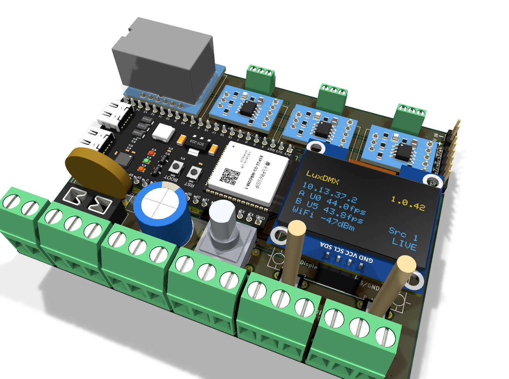

# LuxDMX carrier board

A 2-layer PCB for off-the-shelf modules: an ESP32-S3 dev board, up to three RS-485 modules, a
W5500 Ethernet module and an OLED. Encoder and two buttons sit on the board itself. DMX and RDM on
up to three ports, WS281x pixels on up to five.

The board is built and runs on the bench; most firmware testing happens on it.



| | |
|---|---|
| Board | 100 x 80 mm, 2 layers, 1 oz copper, no mounting holes |
| DMX / RDM | up to 3 ports, one MAX3485 module each, direction pin driven, **not isolated** |
| Pixels | up to 5 WS281x ports, buffered to 5 V by a 74HCT541 |
| Network | WiFi, or wired with a W5500 module |
| Logic supply | USB-C on the ESP module, external 5 V, or a buck module off the pixel rail |
| Pixel supply | 12 or 24 V screw terminal, fused on the board, 9.8 A max |
| UI | 1.3" SH1106 OLED, EC11 encoder with push switch, two buttons |
| Firmware | **ESP32-S3 + PSRAM** image, then the **LuxDMX Carrier** board in `/config` |

Contents: [Modules](#modules) · [Pin map](#pin-map) · [Power](#power) · [DMX ports](#dmx-ports) ·
[Pixel ports](#pixel-ports) · [All parts](#all-parts) · [Build levels](#build-levels) ·
[Ordering](#ordering) · [Assembly](#assembly) · [Before you power it](#before-you-power-it) ·
[Firmware](#firmware) · [Known issues](#known-issues)

## Modules

These are the units the bench board is built with. Other sellers' modules work if pinout and
size match, check both before buying.

| Slot | Module | Pins | Notes |
|---|---|---|---|
| MCU | ESP32-S3-DevKitC-1 clone, **WROOM-1-N16R8**, dual USB-C (Binghe, Amazon.de B0D6B2CYNW). Search `ESP32-S3-DevKitC-1 N16R8` | 2 x 22, official DevKitC-1 pin order | 57.5 x 27.9 mm, rows **25.40 mm** apart. Espressif's own DevKitC-1 has 22.86 mm rows and does **not** fit. Compare the seller's drawing against the footprint before buying |
| RS-485, x3 | MAX3485 module, silk `RS485 V2.01` (RAKSTORE, Amazon.de B0C2HRQ393). Search `MAX3485 TTL to RS485 module 3.3V` | left: GND / A / B<br>right: EN / VCC / RXD / TXD / GND | 3.3 V, not isolated. EN is DE and RE tied together, one GPIO per port, which is what RDM needs. A module without EN can't do RDM. RXD is the module's input (DI), TXD its output (RO); the board crosses them |
| Ethernet | USR-ES1 (W5500). Search `USR-ES1 W5500` | 2 x 6, rows 20.32 mm | 3.3 V only, no LDO on the module. About 132 mA typical. The single-row 8-pin W5500 boards are a different module |
| Display | 1.3" OLED, SH1106, 128 x 64, I2C. Search `1.3 inch OLED I2C SH1106` | board pads 1-4: GND / 3V3 / SCL / SDA | Sits on a 1x4 female socket, 8.5 mm tall, which lifts the glass 10.9 mm clear of the modules. Sold with VCC and GND in either order, read the module's silk |
| Encoder | bare EC11 with push switch, 20 mm D-shaft (the part inside a KY-040) | soldered to the board | GPIO pull-ups are internal, the KY-040's three 10k aren't needed |
| Buttons, x2 | 6 x 6 mm tact switch | soldered to the board | Plunger 5 to 30 mm on the same land. The encoder shaft stands 20 mm, so 30 mm reaches the same front panel |

## Pin map

From the board's nets. Picking **LuxDMX Carrier** in `/config` sets these.

| Function | GPIO |
|---|---|
| DMX 1 TX / RX / DE+RE | 17 / 18 / 16 |
| DMX 2 TX / RX / DE+RE | 15 / 7 / 6 |
| DMX 3 TX / RX / DE+RE | 5 / 4 / 8 |
| W5500 SCLK / MOSI / MISO / CS / INT / RST | 12 / 11 / 13 / 10 / 14 / 9 |
| Pixel 1 / 2 / 3 / 4 / 5 data (before the buffer) | 38 / 39 / 40 / 47 / 48 |
| Display SDA / SCL | 1 / 2 |
| Encoder A / B / switch | 42 / 41 / 21 |
| Button 1 / 2 (to GND) | 3 / 46 |
| `EXP` header | 3V3, GND, 47, 48, 43 (TX0), 44 (RX0) |

Not used, and not usable: 35/36/37 (octal PSRAM on any R8 module), 45 (flash voltage strap), 19/20
(USB), 0 (BOOT). IO48 also drives the module's own RGB LED, see [pixel ports](#pixel-ports).

## Power

### Rails

| Net | Comes from | Feeds |
|---|---|---|
| `+5V` | USB-C on the ESP module, **or** the `5V IN` header, **or** the buck module | ESP module 5V pin, 74HCT541 |
| `+3V3` | the ESP module's own regulator (800 mA on Espressif's design) | ESP32-S3, MAX3485 x3, W5500, OLED, DMX bias, pull-ups |
| `V_PIX_IN` | `12-24V IN` screw terminal | the fuse |
| `V_PIX` | after the fuse | 1000 µF, V+ on all five pixel terminals, buck module input |
| `GND` | one common ground | everything, including DMX pin 1 (the ports are not isolated) |

The 3.3 V load with everything fitted is about 269 mA. The W5500 and WiFi don't run at the same time.

No ORing diodes between the three 5 V sources: **one at a time**. With the buck fitted, don't plug
in USB while the 12/24 V is on.

### Supply setups

| Setup | Fit | Logic from | Pixel rail |
|---|---|---|---|
| DMX only, bench | nothing | USB-C | unused |
| DMX only, in a box | `5V IN` header | external 5 V | unused |
| Pixels, two supplies | 12-24V terminal, fuse, 1000 µF | USB or `5V IN` | 12/24 V |
| Pixels, one supply | as above + buck module | buck, from `V_PIX` | 12/24 V |

### Fuse

Exactly one of these three:

| Option | Part | When |
|---|---|---|
| Polyfuse | Bourns MF-R500 (30 V, 5 A hold, 10 A trip), LCSC C208489 | default. Resets itself after cooling |
| Blade fuse | Keystone 3568 holder, MINI blade fuses (ATM, Littelfuse 297/997) | you'd rather swap a fuse. Not ATO/ATC, those are twice as wide |
| Solder bridge | pad pair on the back, inside the polyfuse footprint | the supply lead already has a fuse |

Polyfuse land: three holes, 5.08 mm (middle, MF-R110 to MF-R400, up to 4 A) and 10.2 mm (right,
MF-R500, up to 9 A). Use **30 V** parts only. MF-RHT, MF-RG and anything else rated 16 V is out of
rating at 24 V the moment it trips. MF-R900 (24 mm body) hits the 1000 µF can. Equivalents to the
MF-R500: ECE RB500-30, Littelfuse RUEF500. Full list in [`production/BOM.md`](production/BOM.md).

Never polyfuse and bridge together.

### Buck module

MP1584EN step-down module. Input max **28 V**, so a 24 V supply must not idle above that. **Set it to
5.0 V before soldering it in**: they ship with the trimmer anywhere, and 12 V on `+5V` kills the ESP32,
the W5500 and the display. Input is `V_PIX`, so it sits behind the fuse.

The land is four 12 x 5 mm pads with a solder-mask grid (7 x 3 windows of 1.1 mm), so modules from
22 x 18 to 30 x 18 mm land. LM2596 modules (43 x 21 mm) do not fit.

### Current rating

The pixel supply runs as 4.8 mm tracks from the inlet through the fuse along the terminal row. Each
output gets the full width and its own 4.8 mm GND return.

| 1 oz copper | 10 K rise | 20 K rise | at 24 V |
|---|---:|---:|---:|
| Pixel rail, fuse to the outputs | 7.2 A | **9.8 A** | 170 - 235 W |
| Pixel rail, inlet to the fuse | 7.3 A | 9.9 A | |
| Any single output | 7.2 A | 9.8 A | |
| GND return per output | 7.4 A | 10.1 A | |
| GND pour overall | 46.3 A | 62.8 A | |

- 10 K: board stays hand-warm. 20 K: fine for FR4, more current. Neither is a safety limit.
- All five ports in use: about 2 A each. A 5 m WS2815 run is about 5 A at full white.
- More than that: inject power at the strip.
- The polyfuse bridge pads limit a fuse-less build to 8.8 A. Bridge the through-holes with a wire for more.
- The bulk cap and buck hang off 2.0 mm spurs (5.3 A), they aren't load paths.

### Decoupling

| Where | Parts |
|---|---|
| 3.3 V at the ESP module | 100 nF + 22 µF |
| W5500, under the module on the back | 100 nF / 1 µF / 22 µF, smallest closest to its 3V3 pin |
| Pixel rail | 1000 µF 35 V, 13 mm can, 5.0 mm pitch |

The W5500 set matters: the 3.3 V reaches it through 62 mm of 0.60 mm track (about 62 nH), so the
local 22 µF is what holds the rail when the PHY steps its load.

## DMX ports

Per port, on the board:

| Part | Connection | Purpose |
|---|---|---|
| MAX3485 module | EN, DI, RO from the pin map | transceiver, 3.3 V |
| 10k | DE+RE to GND | driver off, receiver on while the ESP boots. Without it the driver can key the bus before firmware runs |
| 120 Ω | A to B | termination. Only at the **end** of the bus, and only if the module doesn't already have one |
| 330 Ω | A to 3.3 V | fail-safe bias |
| 330 Ω | B to GND | fail-safe bias, always as a pair with the one above |
| 2 x TVS | A to GND, B to GND | surge clamp for ports that leave the box |
| 3-pin header | 1 GND, 2 B, 3 A | to XLR pin 1 / 2 / 3 |

Bias: RS-485 wants more than 200 mV idle. 330 Ω gives 508 mV with one terminator and 275 mV with two.
270 to 390 Ω are fine, 430 and 470 Ω marginal, 560 Ω and up not enough. Fit it once per bus. Many
MAX3485 modules already carry 120 Ω and bias resistors; check before adding a second set.

TVS: SMF12CA (SOD-123FL, 200 W), or SMAJ12CA (SMA, 400 W). 12 V standoff so it stays off at the
+12 V common mode RS-485 allows, 14.7 V breakdown, 19.9 V clamp at 10 A. A varistor is no
substitute, it clamps around 40 V.

Header: 2.54 mm pitch, 1.20 mm holes. Takes a pin header or a 2.54 mm screw terminal (Phoenix
MPT 0,5/3-2,54, TE 282834-3, Xinya XY308-2.54-3P).

**Not isolated.** DMX GND is board GND. Fine for a desk or a small rig. Use an isolated RS-485
module on a separate build if you need it.

## Pixel ports

```
GPIO 38/39/40/47/48 ── 74HCT541 (5 V) ── 330 Ω ── terminal DATA
                                         V_PIX ── terminal V+
                                           GND ── terminal GND
```

**The buffer is required for pixels.** WS281x need 0.7 x VDD = 3.5 V as logic high on a 5 V strip
input; the S3 gives 3.3 V. Without the buffer nothing reaches the terminals at all, they hang off its
outputs.

### The buffer chip

`74HCT541D,653` (Nexperia), LCSC C547781, about 0.42 EUR. VCC on `+5V`, both output enables tied to
GND, inputs A1 to A5 used, A6 to A8 (pins 7 to 9) tied to GND by a track to pin 10.

Two things decide the part:

1. **The T.** HCT, AHCT and ACT have TTL input thresholds (VIH 2.0 V), so 3.3 V switches them on a
   5 V supply. HC, AHC and AC need 3.5 V and don't switch reliably.
2. **The package.** The land is SOIC-20W: 1.27 mm pitch, rows 10.10 mm apart, pads extended 0.80 mm
   for a soldering iron.

| Fits | Doesn't fit |
|---|---|
| 74HCT541D (Nexperia) | 74HC541, 74AHC541, 74AC541: CMOS thresholds |
| 74AHCT541D (Nexperia) | 74HCT540 / 74AHCT540: inverting, same pinout |
| SN74AHCT541DW, SN74HCT541DW (TI) | 74HCT244: different pinout |
| CD74ACT541M (TI) | `...541PW` (TSSOP 0.65 mm), what LCSC stocks most of |
| | `...541DB`, `...541DGS`, `...541RKS`, `SN74AHCT541NS` (narrow SO-20), DIP |
| | 74LVC541A: can't output 5 V |

### Series resistors

330 Ω per port at the buffer output. The buffer switches in 3 to 5 ns into unterminated strip wire;
that edge rings and overshoots into the first LED. A WS281x bit is 1.25 µs, so the slower edge
costs nothing. The resistor also limits current if DATA meets 5 V or GND. 220 to 470 Ω all work.
Same part as the DMX bias resistors.

### Terminals

5.08 mm, 3 pole: V+ / DATA / GND. Pads 3.60 x 3.30 mm on 1.30 mm holes. Fit the terminal or solder
the wire flat onto the pad.

### Things to know

- **IO48 is pixel port 5 and the module's RGB LED.** The carrier preset turns the status LED off.
  Not using port 5? Status LED back on at GPIO48, WS2812.
- **EXP header** brings out IO47 and IO48 **unbuffered** (3.3 V), alongside the buffered ports 4 and 5.
- **5 V strip works.** The rail is a pass-through and doesn't care about voltage, but 5 V strip needs
  about 3.5 times the current of 12 V strip for the same pixels. The limit here is amps, so the
  firmware defaults to WS2815 (12 V).
- **Driver:** the firmware uses the S3's LCD_CAM peripheral when PSRAM is there, which is why the
  carrier wants the PSRAM image. Chips, universes, power caps: [`docs/pixels.md`](../docs/pixels.md).

### Data line return path

341 mm of data line on the board. Two layers can't give every millimetre a ground plane underneath:

| | |
|---|---:|
| ground directly opposite, other layer | 60 % |
| ground alongside within 1.5 mm | 31 % |
| no ground within reach | 9 % |

The 9 % is 29 mm where the lines cross the supply bus, plus 8.5 mm under the ESP module. For a few
metres of strip this doesn't matter, and the series resistors cover it.

## All parts

Everything that can go on the board. Only the ESP module is mandatory. Small parts are 1206 in the
BOM, the lands take 0402 to 1206.

### Core

| Part | Value / part number | Fit when |
|---|---|---|
| ESP32-S3 module | DevKitC-1 clone, N16R8, 25.40 mm rows | always |

### DMX, per port (x3)

| Part | Value / part number | LCSC | Fit when |
|---|---|---|---|
| RS-485 module | MAX3485, with EN pin | | port used |
| DMX header | 1x3 pin header, or 2.54 mm screw terminal | | port used |
| `10k dir` | 10k, 1206W4F1002T5E | C17902 | port used |
| `120R term` | 120 Ω, 1206W4F1200T5E | | port at the end of the bus, module has none |
| `330R bias+`, `330R bias-` | 330 Ω, 1206W4J0331T5E | C25374 | port drives the bus, once per bus |
| `TVS bidir` x2 | SMF12CA, or SMAJ12CA | C353317 | port leaves the enclosure |

### Pixels

| Part | Value / part number | LCSC | Fit when |
|---|---|---|---|
| `74AHCT541 pixel buffer` | 74HCT541D,653, SO-20 300 mil | C547781 | at least one pixel port used |
| `330R PIX1..5` | 330 Ω, 1206W4J0331T5E | C25374 | that port used |
| `Pixel1..5` | KF128-5.08-3P screw terminal | C474953 | that port used |
| `12-24V IN` | KF128-5.08-2P screw terminal, 24 A | C474952 | any pixel port used |
| `1000uF 35V` | KM108M035J20RR0VH2FP0, D13 x 20 mm | C10749 | any pixel port used |
| Fuse | MF-R500 polyfuse **or** Keystone 3568 blade holder **or** solder bridge | C208489 (MF-R500) | any pixel port used, see [Fuse](#fuse) |

### Supply

| Part | Value / part number | Fit when |
|---|---|---|
| `5V Buck Converter` | MP1584EN module, set to 5.0 V first | logic from 12/24 V, no USB, no `5V IN` |
| `5V IN` | 1x2 pin header | external 5 V instead of USB |
| `100nF` | 100 nF X7R, CL31B104KBCNNNC (C24497) | recommended |
| `22uF 3V3 bulk` | 22 µF 6.3 V X5R, CL31A226MQHNNNE (C159757) | recommended |

### Network

| Part | Value / part number | LCSC | Fit when |
|---|---|---|---|
| `W5500 Ethernet Module` | USR-ES1 | | wired Ethernet |
| `10k ETH_CS pu` | 10k to 3.3 V | C17902 | W5500 fitted. Holds CS high while the GPIOs float during reset |
| `10k ETH_RST pu` | 10k to 3.3 V | C17902 | W5500 fitted. Without it the W5500 resets itself during boot |
| `100nF W5500` | 100 nF | C24497 | W5500 fitted |
| `1uF W5500` | 1 µF X7R, CL31B105KBHNNNE | C1848 | W5500 fitted |
| `22uF W5500` | 22 µF X5R | C159757 | W5500 fitted |

### Interface

| Part | Value / part number | Fit when |
|---|---|---|
| `Display` | 1.3" SH1106 I2C OLED on a 1x4 female socket, 8.5 mm | you want the display |
| `Encoder` | EC11 with push switch, 20 mm D-shaft | you want the on-unit menu |
| `Button 1`, `Button 2` | 6 x 6 mm tact switch, 30 mm plunger | you want the buttons |
| `EXP` | 1x6 pin header | you need spare pins |

LCSC small parts for a fully fitted board: about 2.80 EUR. Stock, prices, marketplace links and
search terms for every module: [`production/BOM.md`](production/BOM.md). Every position with its
side and fit condition: [`ASSEMBLY.md`](ASSEMBLY.md).

## Build levels

| Build | DMX | Pixels | Network | Fit |
|---|---|---|---|---|
| DMX only, USB powered | 1-3 | - | WiFi | ESP, RS-485 module + header + 10k per port, bias / termination / TVS as needed |
| DMX + LAN | 1-3 | - | W5500 | above + W5500, its two 10k and 100 nF / 1 µF / 22 µF |
| Pixels only | - | 1-5 | WiFi | ESP, buffer, 330 Ω + terminal per port, 1000 µF, inlet, fuse, buck or USB |
| Everything | 3 | 5 | W5500 | all of it, plus display, encoder, buttons |

## Ordering

- **PCB:** [`production/luxdmx-carrier-gerbers.zip`](production/), 2 layers, 1 oz, 1.6 mm, any fab
  (e.g. <https://cart.jlcpcb.com/quote>).
- **Small parts:** [`production/BOM-LCSC-upload.csv`](production/) goes straight into
  <https://www.lcsc.com/bom>. Also as `BOM.csv` / `BOM.xlsx`, and `BOM-TME.md` for TME.
- **Modules:** search terms and example links in [`production/BOM.md`](production/BOM.md). Links rot,
  search terms don't.

## Assembly

1. Back side first: all small parts sit under the modules.
2. Then the headers and sockets on the front.
3. Set the buck to 5.0 V, then solder it.
4. Plug in the modules.

Hand soldering only. Resistor and capacitor lands run 0.30 to 2.30 mm off centre, so 0402, 0603,
0805 and 1206 all land on copper (1210 overhangs in width). TVS lands go to 2.90 mm and take
SOD-123, SOD-123F, SOD-123FL, SMA and 1206. The lands are longer than the parts and nothing
self-aligns, so this board doesn't reflow.

## Before you power it

- **One 5 V source at a time.** USB, `5V IN` and the buck share `+5V` with no diodes.
- **Buck set to 5.0 V** before it goes on the board.
- **Polyfuse or bridge or blade fuse**, exactly one.
- **120 Ω only at the end of the bus**, and not on top of the module's own.
- **OLED pin order** against the module's silk: board pads are GND / 3V3 / SCL / SDA.
- **Buffer fitted** if you expect anything on the pixel terminals.

## Firmware

1. Flash **ESP32-S3 + PSRAM** from the [web flasher](https://tombueng.github.io/LuxDMX/) over USB
   (the USB-UART port). This one has to be USB: PSRAM is set up by the bootloader and OTA can't
   change that. Later updates can go over the air.
2. Join the `LuxDMX-setup` access point and put the box on your WiFi.
3. `/config` → board **LuxDMX Carrier** → apply. Sets DMX, W5500, display, encoder and pixel pins.
   Only DMX 1 is enabled, all pixel ports start disabled.
4. Set **Button 1 pin** = 3 and **Button 2 pin** = 46 (see [known issues](#known-issues)).
5. W5500 fitted: **Wired Ethernet PHY** = W5500, then **Use wired Ethernet instead of WiFi**.

From source: `pio run -e luxdmx_carrier` builds an image that boots with the carrier pin map.

## Known issues

- **Boards from gerbers before 2026-10-26: buffer inputs A6 to A8 (pins 7, 8, 9) float.** Unused
  CMOS inputs belong on GND or VCC; left open they can draw extra current and make the unused
  outputs oscillate. The current gerbers tie them to pin 10 (GND) with a track on the back. No
  trace joining pins 7 to 10 on your board means it's an older one: a solder bridge across pins 7
  to 10 does the same job.
- **The /config board preset doesn't set the two buttons.** The firmware template does, the web
  preset doesn't yet. Set them by hand (firmware step 4).
- **Display SDA/SCL not confirmed on hardware.** The nets say SDA = GPIO1, SCL = GPIO2. If a known
  good panel stays dark, swap the two in `/config`; it's harmless.

## Credits

Thanks to mdethmers on the forum for pushing on the pixel GND return, which is why every output now
has a full-width return track.

One 3D model in the renders comes from the GrabCAD Community Library, used under GrabCAD's
non-commercial sharing terms: the ESP32-S3 dev board,
[YD-ESP32-S3](https://grabcad.com/library/yd-esp32-s3-1). The model file itself is not part
of this repository. Selling boards built from this design would make that use commercial,
which needs the original designer's explicit permission.

The OLED module model is a third-party one whose licence has not been established. It is not
part of this repository either, and it only affects how the renders look, not the board.

Everything else in the renders is drawn from KiCad's own libraries.

Hobby project, no certification claimed.
