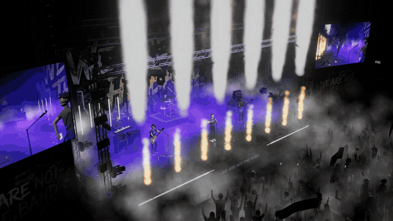
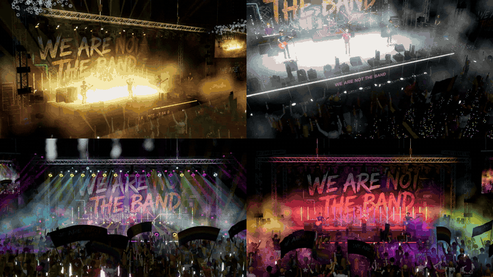
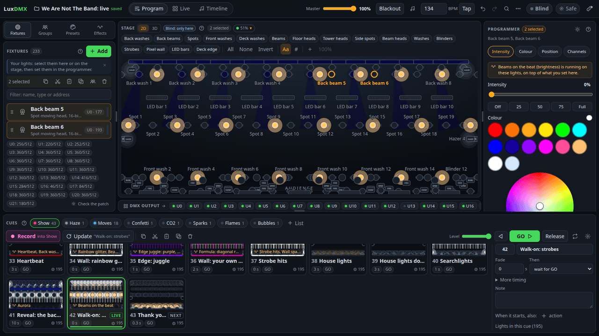
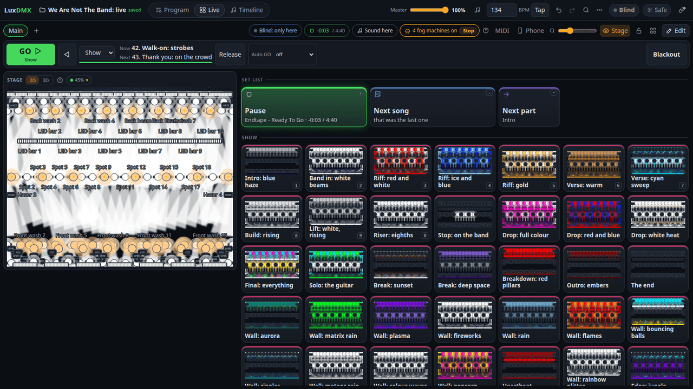
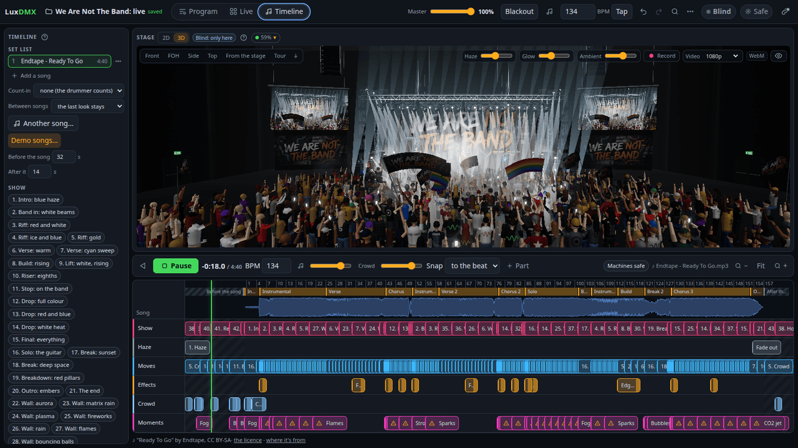
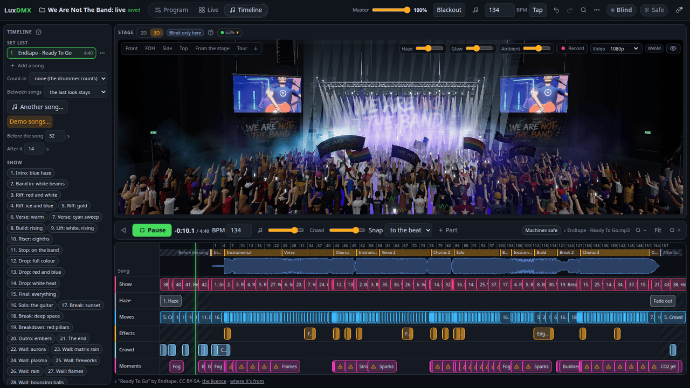

# LuxDMX Sequencer

A lighting console in a browser tab. Patch your lights, build looks, throw effects on them and
play the show from big buttons, your phone or a song's timeline. No install, no account.

<p align="center"></p>

<p align="center"><b><a href="https://tombueng.github.io/LuxDMX/sequencer/">Open it</a></b> ·
<a href="GUIDE.md">The guide</a> · <a href="link/README.md">LuxDMX Link</a> ·
<a href="FORMAT.md">Show file</a> · <a href="SONGS.md">Songs and credits</a> ·
<a href="DEVELOPING.md">Developing</a></p>

## What's in it

- **Plays real lights.** A LuxDMX box through its own bridge page, or any Art-Net / sACN node
  through **LuxDMX Link**, a small helper for Windows, macOS and Linux. Double-click it once and it
  installs itself, no admin rights.
- **2,400 fixtures to search**: 1,781 from QLC+ and 652 from the Open Fixture Library, plus GDTF
  files, plus your own type made by poking the channels of the real light. 16-bit, colour and
  gobo wheels, pixel strips, LED rings and matrices.
- **72 effects.** Chases, circles, fire, lightning, 20 pixel shows (the WLED classics: fire,
  fireworks, matrix rain, bouncing balls...) and 21 for rings and matrices (an eye that wakes up, a
  reactor that blows, a supernova, your own words). Or write your own as a formula, or drop in a
  picture or an animated GIF.
- **A 3D stage.** Beams in haze, moving heads that pan at real speed, flames, sparks, confetti,
  CO2, a band and a crowd. Record it as a video.
- **A timeline.** Put cues, effects and flames on a song: it finds the tempo, the beats and the
  hits. 39 Creative Commons songs come with it.
- **Live pages.** Big buttons and faders, GO, fog only while you hold it, MIDI learn, and your
  phone as a remote (scan a QR code).
- **Safe by default.** It starts Blind. Flames and sparks fire only when armed (hold to arm) and
  cut out on their own.
- **RDM rig check.** Finds the lights on the cable, compares them with your patch and fixes
  addresses and modes.
- **Templates** for a band, a DJ night, theatre, church, cinema and bar. QLC+ workspaces in and out.
- **The DMX runs in its own thread**, so a busy page never makes the lights stutter. Works offline
  once it's loaded.

## The demo

"Show me a demo" on the welcome screen: a festival stage with 233 lights on 22 universes, playing
"Ready To Go" by Endtape. Over a hundred moving heads on the beat, hard changes on the song's
hits, flames, sparks and confetti.

<p align="center"></p>

## Screenshots

| | |
|---|---|
|  |  |
| **Program**: set the lights, record cues, run effects | **Live**: play the show from big buttons |
|  |  |
| **Timeline**: a show on a song | **3D**: see it before the truck's unloaded |

## Running it yourself

```sh
npm ci
npm run dev        # http://localhost:5173
npm test           # about 1,000 unit tests
npm run e2e        # about 310 browser tests, the DMX checked on the wire of a fake box
```

The whole how-to is in [GUIDE.md](GUIDE.md).
